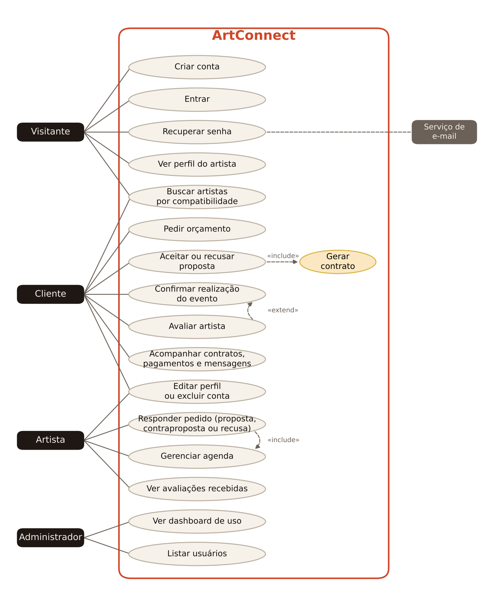

# Diagrama de casos de uso

## Atores

| Ator | Quem é |
|---|---|
| Visitante | Qualquer pessoa que abre o site sem estar logada |
| Cliente | Quem organiza o evento e contrata |
| Artista | Quem presta o serviço (DJ, cantor, chef, fotógrafo...) |
| Administrador | Equipe do ArtConnect |
| Serviço de e-mail | Sistema externo que entrega o link de recuperação de senha |

## Casos de uso

| Caso de uso | Ator | Descrição | Requisito |
|---|---|---|---|
| Criar conta | Visitante | Cadastro como cliente ou artista | RF1, RF2 |
| Entrar | Visitante | Login com usuário e senha | RNF5 |
| Recuperar senha | Visitante | Recebe por e-mail um link com token válido por 30 minutos | RNF5 |
| Ver perfil do artista | Visitante | Descrição, preço, nota e depoimentos | RF5, RF10 |
| Buscar artistas por compatibilidade | Visitante, Cliente | Filtra por categoria e ordena por preço, cidade, data e nota | RF3, RF4 |
| Pedir orçamento | Cliente | Descreve o evento para os artistas da categoria | RF6 |
| Aceitar ou recusar proposta | Cliente | Escolhe entre as propostas recebidas | RF7 |
| Gerar contrato | (incluído) | Ao aceitar, o sistema cria o contrato, o pagamento e bloqueia a agenda | RF7 |
| Confirmar realização do evento | Cliente | Libera o pagamento retido ao artista | — |
| Avaliar artista | Cliente | Nota de 1 a 5 e comentário, depois do evento concluído | RF9, RF10 |
| Acompanhar contratos, pagamentos e mensagens | Cliente | Painel do cliente | RF8, RF12 |
| Editar perfil ou excluir conta | Cliente, Artista | Atualiza os dados ou apaga a conta | RF11 |
| Responder pedido | Artista | Envia proposta, contraproposta de data ou recusa | RF7 |
| Gerenciar agenda | Artista | Marca dias ocupados ou disponíveis | RF5 |
| Ver avaliações recebidas | Artista | Depoimentos no painel do artista | RF10 |
| Ver dashboard de uso | Administrador | Estatísticas da plataforma | — |
| Listar usuários | Administrador | Busca e filtro de contas | — |

## Relações

- **Aceitar proposta «include» Gerar contrato:** toda aceitação gera um contrato. Não existe aceite sem contrato.
- **Avaliar artista «extend» Confirmar realização do evento:** depois de confirmar, o cliente pode avaliar, mas não é obrigado.
- **Responder pedido «include» Gerenciar agenda:** antes de aceitar a data, o sistema consulta a agenda do artista e bloqueia a proposta se o dia estiver ocupado.
